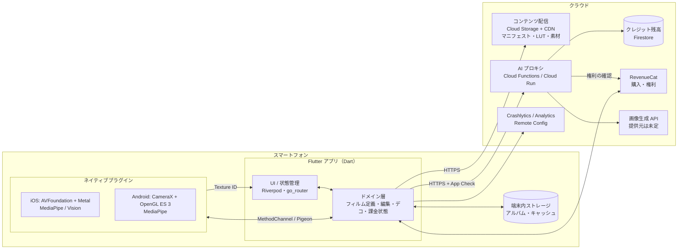

# 07. システム構成（案）

> 要件を満たすための構成案です。M1 の技術検証（PoC）で確定させます。

## 1. 全体構成



## 2. 役割分担（Flutter とネイティブ）

| 層 | 担当 | 理由 |
|---|---|---|
| Flutter（Dart） | 画面・操作・状態管理、フィルムやキャラの定義の読み込み、デコ（落書き・スタンプの編集 UI）、アルバム、課金 UI、通信 | UI を両 OS で共通化する |
| ネイティブ（Swift / Kotlin） | カメラ制御、GPU 描画パイプライン（フィルム・美肌・キャラの合成）、顔ランドマーク、人物セグメンテーション、撮影画像の最終合成 | カメラのフレームを Dart 側に渡すと、遅延とメモリ負荷が大きい（市場調査 [07-technology](../market-research/07-technology.md)）。**映像はネイティブ側で完結**させ、結果を Flutter の `Texture` として表示する |

### Flutter とネイティブ間の I/F（案）
- `startPreview(config)` / `stopPreview()` → Texture ID を返す
- `setFilm(filmDefinitionJson, assetPaths)` / `setBeauty(params)` / `setCharacter(def)`
- `capture()` → 加工後の画像と元画像のファイルパス、メタデータ
- `renderStill(sourcePath, pipelineParams)` → 後から編集するときの静止画の再処理（撮影時と同じパイプライン）
- 型安全な I/F は Pigeon で生成する

## 3. 描画パイプライン（案）

```
カメラのフレーム (YUV/BGRA)
  → 色空間の変換
  → [顔ランドマーク / 肌マスク / 人物マスク]（解析は低解像度で、間引きして実行）
  → 美肌（肌マスク＋エッジを保つ平滑化）→ 顔の微調整（ワープ）
  → キャラ合成（ランドマークに追従する2Dスプライト）
  → 背景の差し替え（プリ。人物マスクを使う）
  → フィルム（LUT → ブルーム → 光漏れ → 粒子 → ビネット・色収差 → 低画素化）
  → 日付印字 / フレーム
  → プレビュー出力（Texture）/ 撮影時はフル解像度で同じ処理
```

**シェーダーの共通化の方式**（PoC で比較）

| 案 | 内容 | 長所 | 短所 |
|---|---|---|---|
| A | GLSL で書き、SPIRV-Cross 等で MSL（Metal 用）に変換する | ソースが1つ | ビルド工程が複雑になる |
| B | Metal と GLSL で別々に書く | 素直で、デバッグしやすい | 二重に保守する必要がある |
| C | Flutter の FragmentProgram（Impeller）で、Texture に `ImageFilter.shader` を適用する | Dart 側で完結する | カメラの Texture や多段のパス、マスク入力への対応、性能が未検証 |

→ M1 で C の実現性を最初に確認します。だめなら A、それも難しければ B にします。

## 4. フィルム定義（データ）の例

```json
{
  "id": "ccd_2005",
  "name": "平成デジカメ 2005",
  "tier": "free",
  "version": 1,
  "assets": {
    "lut": "luts/ccd_2005.png",
    "lightLeaks": ["leaks/warm_01.png", "leaks/warm_02.png"]
  },
  "params": {
    "lutIntensity": 1.0,
    "bloom": { "threshold": 0.8, "radius": 6, "intensity": 0.35 },
    "grain": { "amount": 0.12, "size": 1.2, "lumaResponse": 0.6 },
    "lightLeak": { "probability": 0.5, "opacity": [0.2, 0.5] },
    "vignette": 0.25,
    "chromaticAberration": 0.002,
    "downscale": { "enabled": true, "longEdge": 1600 },
    "dateStamp": { "default": true, "style": "seg7_orange" }
  }
}
```

キャラ・プリの台紙・スタンプ・AI スタイルも、同じようにマニフェストと素材で定義します。

## 5. 技術選定（候補）

| 領域 | 候補 | 備考 |
|---|---|---|
| 状態管理 / 画面遷移 | Riverpod / go_router | |
| ネイティブとの I/F | Pigeon | |
| 顔ランドマーク | MediaPipe Face Landmarker（両 OS） | 両 OS で挙動をそろえる。iOS は Vision でも可 |
| 人物セグメンテーション | MediaPipe Image Segmenter / iOS Vision | |
| 課金 | RevenueCat（purchases_flutter） | |
| バックエンド | Firebase（Anonymous Auth、Functions、Firestore、Storage、App Check、Remote Config、Crashlytics、Analytics） | 個人開発の運用負荷を最小にする |
| 画像生成 AI | Google Gemini の画像モデル / OpenAI の画像 API / fal.ai 経由の各モデル など | 品質・価格・学習に使わない条件・日本語でのモデレーションで比較する（[06-open-issues](06-open-issues.md)） |
| CI/CD | GitHub Actions ＋ fastlane | |
