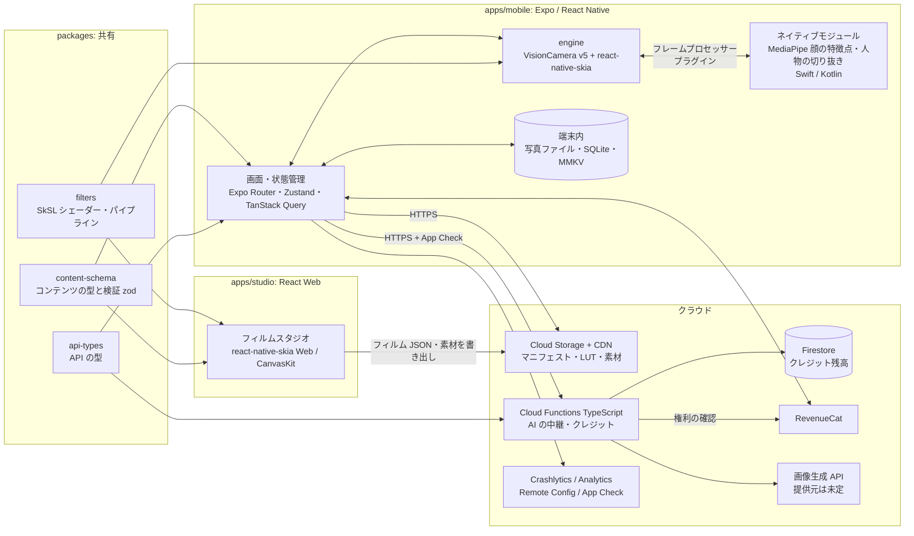

# 07. システム構成

| 項目 | 内容 |
|---|---|
| 版 | v0.2（2026-10-24。Flutter 案から変更） |
| 決定事項 | [06-open-issues](06-open-issues.md) の D-02 / D-06 |

## 1. 基本方針

**フレームワークを混ぜるのではなく、役割ごとに一番合う技術を割り当て、共通にできる部分は1か所にまとめる。**

| 方針 | 内容 |
|---|---|
| 言語は TypeScript に統一 | アプリ・Web ツール・サーバー・型定義をすべて TypeScript で書く（開発者の経験5年を活かす） |
| シェーダーは1つのソース | 加工処理（SkSL）を `packages/filters` にまとめる。**アプリのプレビュー・フル解像度での保存・Web のフィルムスタジオ**の3か所で同じコードを動かす |
| ネイティブは最小限 | JS / Skia では性能が足りない処理（顔の特徴点・人物の切り抜き、必要なら美肌）だけをネイティブモジュールにする |
| コンテンツはデータ | フィルム・キャラ・台紙・スタンプ・AI スタイルは、JSON と素材ファイルで定義する。アプリを更新せずに配信する |

**採用しない構成**
- Flutter と React Native を1つのアプリに同居させる構成: 動作の土台が2重になり、サイズ・ビルド・デバッグの負荷が大きい
- カメラを WebView で動かす構成: 性能・画質が足りない

## 2. 全体構成



## 3. リポジトリ構成（モノレポ）

```
fanT/
├── apps/
│   ├── mobile/                 … Expo（React Native）アプリ
│   │   ├── app/                … 画面（Expo Router のファイルベースルーティング）
│   │   ├── src/
│   │   │   ├── features/       … camera / film / beauty / character / puri / ai /
│   │   │   │                     edit / deco / album / paywall / settings / onboarding
│   │   │   ├── engine/         … カメラと描画パイプラインの結線（VisionCamera + Skia）
│   │   │   │                     ※外部ライブラリの API はここに閉じ込める
│   │   │   └── lib/            … API クライアント・課金・分析・ストレージ
│   │   └── modules/            … ローカルのネイティブモジュール
│   │       ├── face-landmarker/ … MediaPipe Face Landmarker（Swift / Kotlin）
│   │       └── segmenter/       … MediaPipe Image Segmenter（Swift / Kotlin）
│   ├── studio/                 … フィルムスタジオ（社内ツール, Vite + React）
│   └── web/                    … 宣伝用サイト（Next.js。リリース前に作る）
├── packages/
│   ├── filters/                … ★SkSL シェーダー、パイプラインの組み立て、uniform の生成
│   ├── content-schema/         … フィルム・キャラ・台紙・スタンプ・AI スタイルの型と検証（zod）
│   ├── api-types/              … アプリとサーバー間のリクエスト・レスポンスの型（zod）
│   └── config/                 … tsconfig / ESLint / Prettier の共通設定
├── functions/                  … Firebase Cloud Functions（TypeScript）
├── content/                    … 配信コンテンツの原本（JSON・LUT・素材）
│                                 → CI で検証してから Cloud Storage へアップロード
└── docs/
```

- パッケージ管理: **pnpm workspaces**。タスク実行とキャッシュは **Turborepo**
- `packages/filters` は、Skia の API オブジェクトを引数で受け取る形で書きます。React Native 版の Skia とブラウザ版の Skia（CanvasKit）の両方で、同じ関数を呼べるようにするためです。

## 4. 層ごとの担当

| 層 | 技術 | 担当 | 理由 |
|---|---|---|---|
| 画面 | React Native（Expo）、Expo Router | 全画面・操作・デコの編集 UI・アルバム・課金 UI | 生産性が高く、TypeScript の経験を活かせる |
| 状態管理 | Zustand（端末内の状態）、TanStack Query（サーバーのデータ） | 撮影設定・選んでいるフィルム・権利・マニフェスト | 軽量で、扱う範囲がはっきりしている |
| アニメーション・ジェスチャー | Reanimated、Gesture Handler、react-native-worklets | スタンプの拡大縮小・回転、シートの操作 | UI スレッドで滑らかに動く |
| カメラ制御 | **VisionCamera v5** | プレビュー・撮影・前後カメラの切り替え・ズーム・露出・フラッシュ | 両 OS 対応で最も成熟している。v5 で Nitro Modules を使って作り直され、フレームプロセッサーのプラグインも型安全になった |
| リアルタイム加工 | **react-native-skia**（SkSL） | 美肌・フィルム・キャラのスタンプ・背景合成・日付印字 | 両 OS と Web で同じシェーダーが動く |
| 顔の特徴点・人物の切り抜き | **ネイティブモジュール**（MediaPipe Tasks） | 顔ランドマーク、人物・肌のマスク | JS では性能が足りない。VisionCamera のフレームプロセッサーのプラグインとして実装する |
| 端末内ストレージ | expo-file-system、expo-media-library、expo-sqlite、react-native-mmkv | 写真ファイル・アルバムの一覧・設定 | |
| 課金 | react-native-purchases（RevenueCat） | 年額・買い切り・クレジットの購入、権利 | |
| Firebase | @react-native-firebase | 匿名認証・App Check・Remote Config・Crashlytics・Analytics | |
| サーバー | Cloud Functions（TypeScript）＋ Firestore | AI の中継・クレジット残高・コンテンツの一覧 | アプリと型を共有できる |
| フィルムスタジオ | Vite + React + react-native-skia（Web / CanvasKit） | フィルムの制作・確認・書き出し | アプリと同じシェーダーで、同じ見た目を確認できる |

## 5. 描画パイプライン

### 5.1 プレビュー（リアルタイム）

```
VisionCamera のフレーム（フレームプロセッサー / worklet スレッド）
  ├─▶ [ネイティブ] 顔の特徴点   … 低解像度で処理し、間引く（例: 2フレームに1回）。結果は補間する
  ├─▶ [ネイティブ] 人物・肌のマスク … 美肌・プリの背景で必要なときだけ
  └─▶ Skia: フレームを SkImage として受け取る
        → 美肌シェーダー（肌マスク × エッジを保つ平滑化。1パスでの実装を目指す）
        → 顔の微調整（控えめなワープ）
        → キャラのスタンプ（特徴点の位置に画像を描く）
        → 背景の差し替え（人物マスクを使う）
        → フィルムシェーダー（LUT → ブルーム → 光漏れ → 粒子 → ビネット・色収差 → 低画素化）
        → 日付印字 / フレーム
        → プレビューに表示
```

- フレーム処理は worklet スレッドと GPU で行い、**JS スレッドを止めない**ようにします。
- フレームレートが目標を下回ったら、品質を自動で下げます（[03](03-non-functional-requirements.md) §2）。

### 5.2 撮影・保存（フル解像度）

Skia で描いた加工は、カメラの撮影画像には直接乗りません（VisionCamera の制約）。そこで、**元の写真を撮ってから、同じパイプラインを画面外でかけ直す**方式にします。

```
シャッター
  → その時点のパイプラインのパラメーターと乱数シード（光漏れ・粒子のパターン）を記録する
  → takePhoto（フル解像度・加工なし）→ 元画像としてアプリ内に保存する（CAM-04）
  → 静止画モードで顔の特徴点・マスクを再検出する
  → packages/filters の同じシェーダー・パラメーター・シードで、画面外の Skia サーフェスに描く
  → JPEG にエンコード → 保存（EXIF の位置情報を削除）
```

- 乱数シードを記録しておくことで、**プレビューで見た光漏れのパターンと、保存結果が一致**します。
- 後から編集（EDT-01、EDT-02）も同じ「静止画のかけ直し」の処理を使い回します。

### 5.3 フィルムスタジオ（Web）

```
サンプル画像 / Web カメラ
  → packages/filters の同じシェーダー（CanvasKit）
  → パラメーターをスライダーで調整し、LUT を読み込む（.cube から PNG に変換）
  → content-schema で検証
  → フィルム JSON と素材を書き出す → content/ にコミット → CI で検証・アップロード
```

## 6. ネイティブとの境界（I/F 案）

| I/F | 種別 | 入出力 |
|---|---|---|
| `detectFaces(frame, { maxFaces, mode })` | VisionCamera のフレームプロセッサーのプラグイン（Nitro） | 正規化した顔の特徴点の配列、顔の矩形 |
| `segmentPerson(frame, { kind })` | 同上 | 人物マスク / 肌マスク（ネイティブバッファー → Skia Image に**コピーせずに**変換することを目指す） |
| `detectFacesInImage(uri)` / `segmentImage(uri)` | Expo Module | 静止画のかけ直し・後から編集用 |
| Instagram ストーリーズへの共有 | Expo Module（または既存ライブラリ） | 画像を渡して共有する（SHR-03） |

## 7. フィルム定義（データ）の例

```json
{
  "id": "ccd_2005",
  "name": "平成デジカメ 2005",
  "tier": "free",
  "version": 1,
  "pipeline": "film_v1",
  "assets": {
    "lut": "luts/ccd_2005.png",
    "lightLeaks": ["leaks/warm_01.png", "leaks/warm_02.png"]
  },
  "params": {
    "lutIntensity": 1.0,
    "bloom": { "threshold": 0.8, "radius": 6, "intensity": 0.35 },
    "grain": { "amount": 0.12, "size": 1.2, "lumaResponse": 0.6 },
    "lightLeak": { "probability": 0.5, "opacity": [0.2, 0.5] },
    "vignette": 0.25,
    "chromaticAberration": 0.002,
    "downscale": { "enabled": true, "longEdge": 1600 },
    "dateStamp": { "default": true, "style": "seg7_orange" }
  }
}
```

- `pipeline` はアプリに組み込まれたシェーダーの種類を指します。配信するのは**パラメーターと素材だけ**で、シェーダーのコード自体は配信しません（ストアの審査ガイドラインへの配慮）。
- 新しい種類のシェーダーが必要になったら、アプリを更新して `film_v2` などを追加します。

## 8. 技術選定のまとめ

| 領域 | 採用 |
|---|---|
| アプリ | Expo（開発開始時点の最新の安定版 SDK）、Dev Client（独自のネイティブモジュールを使うため Expo Go は使わない） |
| 画面遷移 | Expo Router |
| 状態管理 | Zustand / TanStack Query |
| カメラ | react-native-vision-camera v5（バージョンを固定して使う） |
| 描画 | @shopify/react-native-skia（SkSL の RuntimeEffect） |
| 顔の特徴点・切り抜き | MediaPipe Tasks（iOS / Android）を自作の Nitro モジュールで包む |
| 型と検証 | TypeScript（strict）、zod |
| 課金 | RevenueCat（react-native-purchases） |
| バックエンド | Firebase（匿名認証・Functions・Firestore・Storage・App Check・Remote Config・Crashlytics・Analytics） |
| 画像生成 AI | 未定（Q-04） |
| Web | Vite + React（スタジオ）、Next.js（宣伝用サイト） |
| モノレポ | pnpm workspaces + Turborepo |
| ツールチェーン（雛形で確定） | Node.js 24 LTS、pnpm 12、TypeScript 6.0（Expo SDK 58 の推奨版。typescript-eslint が 7.0 未対応のため）、ESLint 10 ＋ typescript-eslint ＋ eslint-plugin-react-hooks（`eslint-config-expo` はサポートが終了した ESLint 9 に依存するため使わない） |
| テスト | Vitest（packages）、Jest + React Native Testing Library（アプリ）、シェーダーのゴールデン画像テスト（ヘッドレスの CanvasKit で描いて ΔE で比較）、Maestro（E2E）。CanvasKit は react-native-skia が内部で使う版に合わせる |
| CI/CD | GitHub Actions（lint・型チェック・テスト・コンテンツの検証）、EAS Build / EAS Submit / EAS Update |

## 9. ストア審査なしの JS 配信（EAS Update）の運用方針

| 項目 | 方針 |
|---|---|
| 対象 | JS とアセットの不具合修正・UI の微調整のみ |
| 対象外 | ネイティブコードの変更、主要な機能の追加・変更（ストアの審査を通す） |
| 互換性 | `runtimeVersion` でネイティブ層とのバージョンをそろえる |
| 段階配信 | 一部のユーザーに先に配り、クラッシュ率を見てから全体に広げる |

## 10. 技術検証（M1）で確かめること

| # | 検証項目 | 合格の基準 | 不合格だった場合 |
|---|---|---|---|
| P-1 | Skia の加工（LUT・粒子・美肌の1パス）と MediaPipe の顔検出を同時に動かしたときの性能 | 推奨端末・最低端末とも 24fps 固定を維持（D-07） | 美肌をネイティブモジュールに移す（Q-03） |
| P-2 | ネイティブのマスクを Skia にコピーせずに渡せるか | 1フレームあたり 3ms 以内 | マスクを低解像度にする、または間引く |
| P-3 | 1,200万画素の写真の画面外でのかけ直し | 推奨端末で2秒以内、メモリのピーク 600MB 以下 | 処理をタイル分割する |
| P-4 | iOS・Android・Web（CanvasKit）の出力の一致 | ゴールデン画像との ΔE の平均が 3 以下 | プラットフォームごとに補正値を持つ |
| P-5 | VisionCamera v5 と Expo（Dev Client）の組み合わせの安定性 | 主要な端末で、30分の連続操作でクラッシュしない | バージョンを固定し、問題があれば上流に報告する |

### 10.1 結果（Pixel 7a・リリースビルド）

| # | 結果 | 日付 |
|---|---|---|
| P-1 | フィルムのみ：**合格**（24fps 固定を維持。暗い場所の背面カメラも含む）。美肌（beauty_v1）を加えた状態と、顔検出を加えた状態は未計測 | 2026-10-25 |
| P-3 | **合格**（撮影から保存まで 0.8〜1.4秒。Skia のオブジェクトを明示的に破棄する修正の後、メモリのピークは基準内） | 2026-10-25 |
| P-5 | 修正の後、10分間のプレビューでクラッシュなし。30分の連続操作は未実施 | 2026-10-25 |
| P-2 / P-4 | 未実施（P-2 は MediaPipe の導入後） | — |
